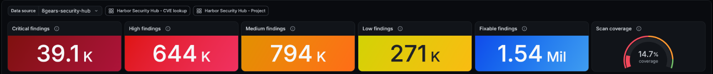
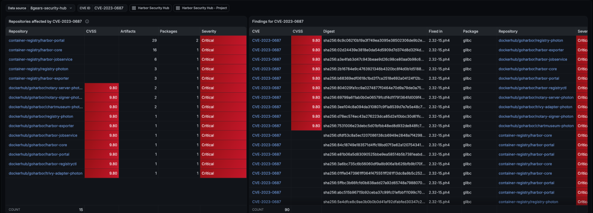
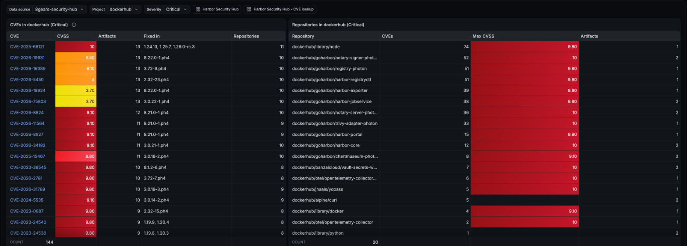

# Harbor Security Hub dashboard

A Grafana dashboard that shows the vulnerability data of a Harbor instance: how
exposed the registry is overall, where a given CVE is, and what a project has
to fix first. [Download the dashboard JSON](../../deploy/chart/dashboards/harbor-security-hub.json)
(UID `harbor-security-hub`).

| Section | Selector | Answers |
|---------|----------|---------|
| Overview (top) | none | Totals per severity, fixable findings, scan coverage, top 5 CVEs and artifacts |
| CVE lookup (collapsed row) | CVE ID | Which repositories and artifacts carry a CVE, and in which package |
| Project (collapsed row) | Project, Severity | Which CVEs affect the most artifacts in a project, and which repositories carry them |

The CVE lookup and Project rows start collapsed. Grafana does not query a
collapsed row, so opening the dashboard sends one request to Harbor, and each
row sends its own requests only when you expand it.

The dashboard reads the [Security Hub API](../../api/v2.0/swagger.yaml)
(`/security/summary`, `/security/vul`) through the
[Infinity datasource](https://grafana.com/grafana/plugins/yesoreyeram-infinity-datasource/).
Every panel queries Harbor live when it is shown. Nothing is scraped or stored, so
the time picker is hidden and has no effect. For time series of Harbor itself,
use the [Harbor dashboard](README.md).

## Preview

Overview:



CVE lookup row:



Project row:



## Navigation

The CVE ID, Project and Severity selectors sit at the top of the dashboard, as
Grafana places every variable there. The row titles show the current value, for
example **CVE lookup: CVE-2023-44487**. Click a row title to expand or collapse it.

- A **CVE** opens a menu: **Where is this CVE?** sets the CVE ID to it,
  **Open in NVD** opens the NVD entry.
- A **Repository** sets the Project to its project, at the severity of the
  finding in the CVE lookup and at Critical from the overview.

Links keep the other selectors and the data source. They cannot expand a row,
so expand **CVE lookup** or **Project** once after following a link; Grafana
keeps it open while you stay on the dashboard.

## Prerequisites

- Harbor 2.9 or later with a default vulnerability scanner. Only reports of the
  default scanner are counted.
- The Infinity datasource plugin in Grafana. Tested with Infinity 4.1.6 on Grafana 13.
- A robot account with read access to the Security Hub. Security Hub is a
  system-level resource, so a **system administrator** has to create it.

### Robot account

Create a system robot account with only these permissions:

| Resource | Actions | Used for |
|----------|---------|----------|
| Security Hub | Read, List | `/security/summary`, `/security/vul` |
| Project | List | The Project selector |

In the portal, open **Administration → Robot Accounts → New Robot Account**,
select **Security Hub** and **Project** under the system permissions, and leave
the project list empty. With the API:

```sh
curl -u admin -X POST https://harbor.example.com/api/v2.0/robots \
  -H 'Content-Type: application/json' -d '{
    "name": "grafana-security-hub",
    "description": "Grafana Security Hub dashboard (read-only)",
    "level": "system",
    "duration": -1,
    "permissions": [{"kind": "system", "namespace": "/", "access": [
      {"resource": "security-hub", "action": "read"},
      {"resource": "security-hub", "action": "list"},
      {"resource": "project", "action": "list"}]}]}'
```

The response holds the robot's full name, including its prefix (default `robot$`),
and its secret. The robot cannot pull, push or change anything.
`"duration": -1` means it never expires. Choose an expiry instead if your policy
requires rotation, and update the datasource when you refresh the secret.

### Infinity datasource

Create an Infinity datasource with:

| Setting | Value |
|---------|-------|
| Base URL | `https://harbor.example.com/api/v2.0` |
| Authentication | Basic authentication, the robot's full name and secret |
| Allowed hosts | `https://harbor.example.com` |

The panels use relative URLs such as `/security/vul`, so the Harbor address
comes only from the datasource. One datasource per Harbor instance; pick it in
the **Data source** selector.

Anyone who can query this datasource sees the vulnerability data of every
project, with the robot's permissions rather than their own. Restrict the
datasource and the dashboard folder with Grafana permissions if that is not
intended.

## Import and provisioning

1. Download `deploy/chart/dashboards/harbor-security-hub.json`.
2. In Grafana, open **Dashboards → New → Import** and import the file.
3. Choose the Infinity **Data source** at the top.

Keep the UID `harbor-security-hub`: the data links use it.

With the [Harbor Next Helm chart](../../deploy/chart/README.md), set
`metrics.grafanaDashboard.securityHub.enabled: true`. The chart ships the
file in a second ConfigMap with the namespace, labels and annotations of
`metrics.grafanaDashboard`, for the same dashboard sidecar. It does not need
`metrics.enabled` and does not create the robot or the datasource.

## Reading the numbers

- **Findings, not CVEs.** The severity tiles sum the reports of all scanned
  artifacts. A CVE in a base image used by 300 artifacts counts 300 times.
- **Scan coverage is a lower bound.** It divides scanned artifacts by every
  artifact row, which includes signatures, SBOMs and index children that are
  never scanned.
- **Severity and CVSS can disagree.** Severity is what the scanner reports, often
  from the distribution's advisory. CVSS is the NVD v3 score, empty when the
  scanner has none.
- **Every stored artifact counts,** including old tags nobody pulls.
- **Duplicates collapse.** The API can return identical rows for one package;
  the tables show them once.

## Limits

- Each table shows at most 1000 findings (10 pages of 100, the API maximum).
  Every page is a separate query because Infinity's built-in pagination fails on
  Harbor's empty last page.
- The Project selector lists the first 100 projects.
- Filters are exact matches. An empty CVE ID returns HTTP 400, so the CVE lookup
  always needs a value.
- Project-filtered queries scan the vulnerability tables and take a few seconds
  per page on large instances.
- Project members without system access cannot use this dashboard with their
  own credentials: the Security Hub API requires system-level access.

## Load on Harbor

The dashboard does not refresh on its own. Harbor only receives requests
when someone opens the dashboard, expands a row or changes a selector:

| Section | Requests |
|---------|----------|
| Overview | 1 × `/security/summary`, 1 × `/projects` for the Project selector |
| CVE lookup, when expanded | 10 × `/security/vul` |
| Project, when expanded | 10 × `/security/vul` |

Each `/security/vul` page runs its own database query, including the pages
after the last result. CVE lookups use the `cve_id` index and are fast.
Project and severity filters scan more rows.

Enable [query caching](https://grafana.com/docs/grafana/latest/administration/data-source-management/#query-and-resource-caching)
on the Infinity datasource where your Grafana supports it (Grafana Cloud,
Grafana Enterprise). Scan results only change when artifacts are scanned, so
the default TTL of five minutes is safe, and repeated views within the TTL
send no requests to Harbor.

## Why not Prometheus metrics

Per-CVE metrics need one series per project, repository and CVE. That grows
with images times CVEs, churns with every vulnerability database update, and
runs a large join on the Harbor database on every scrape. The Security Hub API
answers the same questions on demand, only when someone looks. Aggregates such
as findings per project and severity remain a good fit for metrics and alerting.

## Editing

Edit the JSON files directly, or import them, edit in Grafana and export the
classic dashboard JSON back. Before saving an export:

- Keep the UID, the `harbor-security-hub` tag and the panel IDs. The data links
  depend on them.
- Keep the CVE lookup and Project rows collapsed in the saved JSON, so opening
  the dashboard does not query them.
- Keep `${datasource}` in every target and in the data links
  (`var-datasource=${datasource}`).
- Keep the ten page queries (refIds `A` to `J`) in the first table of the CVE
  lookup and Project rows. The second table reuses them through the
  `-- Dashboard --` datasource, so each row fetches every page once. Keep
  the `merge` transformation in both tables.
- Keep the single `/security/summary` query in panel 1 of the overview. Its
  JSONata root selector turns the response into rows tagged `summary`, `cve` and
  `artifact`; the other panels reuse it through `-- Dashboard --` and keep
  their rows with a `filterByValue` transformation on `kind`.
- Keep `${cve:percentencode}` in the CVE lookup URLs.
- Remove the Grafana database `id` and revision `version`, and clear every
  variable's `current` to `{}` and `options` to `[]`.

Then run the chart checks from the repository root:

```sh
task helm:helm-lint helm:helm-template helm:unittest helm:examples
```
